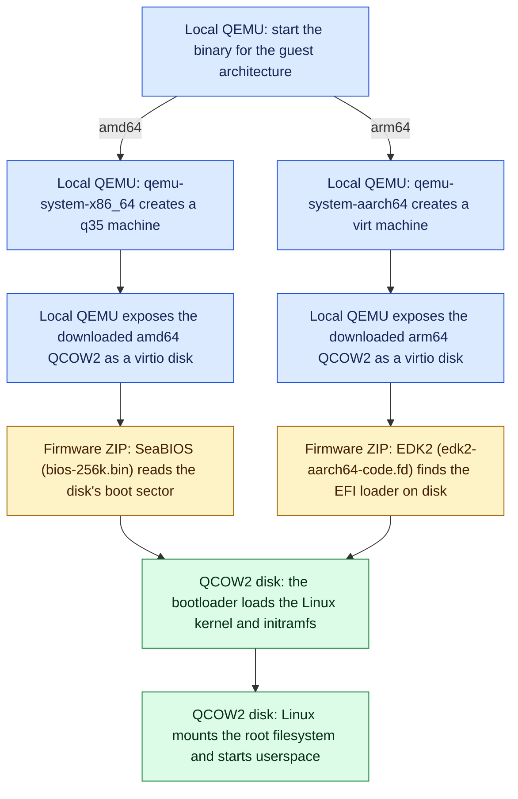

# Backgrounder VMs

The idea is to have these VMs ready for isolating agentic workflows but the focus is on a wider set of applications that can be driven by an agent, e.g. Blender, without the need to surrender access to your host. CI prebuilds and stores VMs in GitHub releases page along with the firmware. User application would then discover and download the VMs along with its card which describes it to the agent so that it knows what software is available. Runtime needs to be able to boot the VM and forward the agent task execution to it.

## How QEMU boots these VMs

**Same boot chain across host operating systems, but not every QEMU setup.**
On Linux, macOS, or Windows, follow the branch for the **guest disk's architecture**,
not the host's. The diagram applies when your QEMU installation includes the
system emulator and machine shown and you use the matching release firmware.
It does not describe QEMU user-mode emulation or direct kernel boot.



**Diagram key:** Blue steps use software installed locally with QEMU. Gold steps
run code from this repository's **firmware ZIP**; green steps run code from its
**QCOW2 disk**. Some QEMU packages also install firmware locally. The path shown
here uses the release ZIP explicitly.

## Download a VM

Download a **QCOW2** base disk (VM) from
[Releases](https://github.com/ivarprudnikov/backgrounder-vms/releases). Each VM has a card describing what it is.

Download the matching `.sha256` file into the same directory and verify:

```sh
shasum -a 256 -c ubuntu-noble-minimal-amd64.qcow2.sha256
```

## QEMU firmware

Choose the firmware archive for the **guest architecture**: `qemu-firmware-amd64.zip`
contains SeaBIOS for x86 guests; `qemu-firmware-arm64.zip` contains EDK2 for
ARM guests. Both include boot ROMs, not QEMU executables or VM disks.

`-L` tells QEMU where to find the extracted ROMs; `-bios` selects the firmware
the guest CPU runs first. `-drive` attaches the separate VM disk; the firmware
sees a virtio disk, not a QCOW2 file.

For example, download the ARM64 archive, its `.sha256` file, and the ARM64
Ubuntu disk from the same release. With QEMU installed, boot the disk using
the extracted firmware (`-snapshot` leaves the downloaded disk unchanged):

```sh
shasum -a 256 -c qemu-firmware-arm64.zip.sha256 &&
  unzip -q qemu-firmware-arm64.zip -d firmware-arm64 &&
  qemu-system-aarch64 -machine virt -cpu cortex-a72 -m 2048 -nographic \
    -L firmware-arm64 -bios edk2-aarch64-code.fd -snapshot \
    -drive file=ubuntu-noble-minimal-arm64.qcow2,format=qcow2,if=virtio
```

## Build and launch locally

To package the firmware locally from a Homebrew QEMU installation:

```sh
python3 scripts/firmware.py --arch arm64 --share "$(brew --prefix qemu)/share/qemu"
```

From the repository root, with Python 3, curl, QEMU (`qemu-img` and the
native system emulator), and either macOS `hdiutil` or Linux `genisoimage`:

```sh
python3 scripts/build.py         # all VMs, host architecture
python3 scripts/test.py          # boot each disk and run its own tests
python3 scripts/build.py --vm debian-trixie-generic
python3 scripts/test.py --vm debian-trixie-generic
```

Linux ARM also needs
`qemu-efi-aarch64`. The smoke test boots an overlay, runs Bash and Python
through cloud-init, verifies a guest success message on the serial console,
and shuts down. Its overlay and seed are temporary.

## Repository layout

Each directory in [vms/](vms/) is one VM. Its name is the release filename
prefix; for example [ubuntu-noble-blender/](vms/ubuntu-noble-blender/) produces
`ubuntu-noble-blender-<arch>.qcow2`. Firmware is packaged separately and
shared by all VMs of the same architecture.

| File | Responsibility |
| --- | --- |
| `vms/<name>/card.md` | Describe tools, guest commands, expected outputs and limits. The builder adds the disk-specific metadata. |
| `vms/<name>/parameters.py` | For an upstream disk, declare `URL` (with `{arch}`), `ALGORITHM`, and `DIGESTS` keyed by architecture. For a derived disk, declare `BASE` (another directory name) and `bake(base, output, work)` to write the standalone QCOW2. |
| `vms/<name>/test.py` | Define `run(image, work, output_dir)` to validate the finished disk. Use `work` for temporary files and `output_dir` for publishable samples with unique filenames. Raise on failure. |
| [`scripts/firmware.py`](scripts/firmware.py) | Select the QEMU data files for each architecture and write `dist/qemu-firmware-<arch>.zip` and its `.sha256` checksum. |

Keep VM-specific assets beside these files. The build resolves dependencies,
and the local test runner and tag workflow discover the same catalog; no VM
registry edit is needed. Release builds currently target both amd64 and arm64.

## Publish

Push a new tag on a commit containing [the workflow](.github/workflows/release.yml),
for example `git tag v1.0.0 && git push origin v1.0.0`. Distributions
are built and boot-tested on each architecture before publication. Hyphenated
tags (e.g. `v1.0.0-test.1`) create public prereleases, not the latest release.
